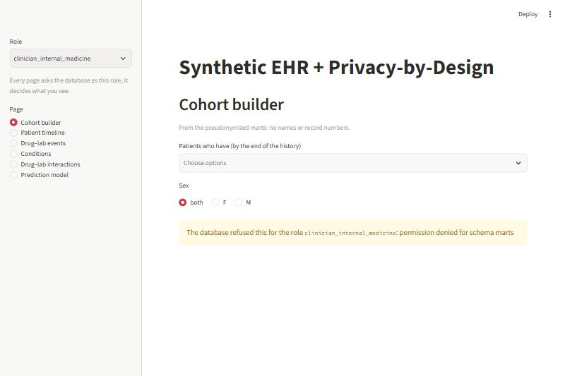
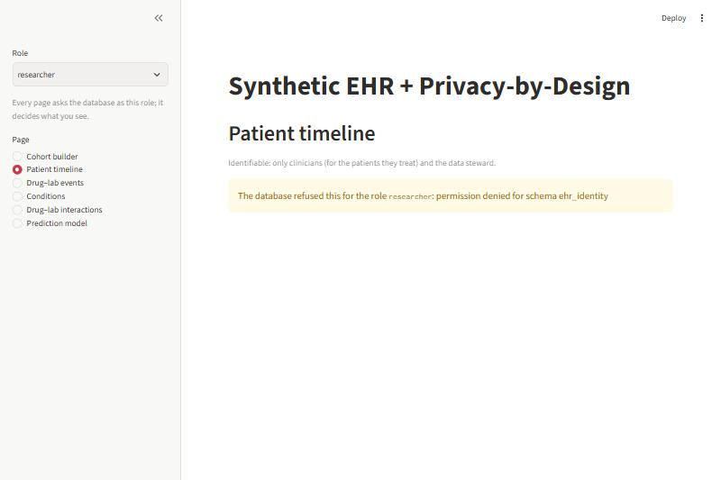
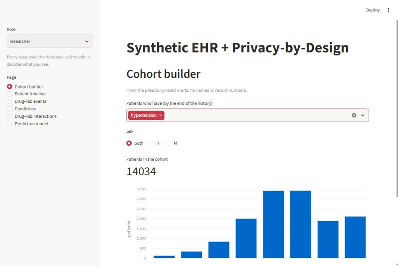

# Synthetic EHR + “Privacy-by-Design”

A realistic but entirely fake electronic health record, generated from a seed, and protected as if it were real.

**Live app (public view, suppressed aggregates only):** <https://synthetic-ehr-privacy-by-design-ucswktrx7cpdpshaaboc9n.streamlit.app>. It sleeps after a while without visitors; the first load can take a few seconds.

The plan is in [docs/project-spec.md](docs/project-spec.md); the clinical rules and the sources of their numbers are in [docs/clinical-rules.md](docs/clinical-rules.md).

## Generate the data

```
python -m uv sync
python -m uv run python -m generator                  # 40,000 patients into data/ (about 2.5 minutes)
python -m uv run python -m generator --population 200 --out data/small
```

It writes one CSV file per table, the identity table apart in `ehr_identity/`, and `manifest.sha256`. The same seed, config and locked dependencies (`uv.lock`) give byte-identical files; check them with `sha256sum -c manifest.sha256` in the output folder. `data/` is never committed: it is regenerated from the seed.

## Run the database

PostgreSQL 16 runs locally in Docker, on `127.0.0.1:5433` only. It needs two settings in `.env` (gitignored, never committed):

```
POSTGRES_PASSWORD=<a long random password>
DATABASE_URL=postgresql://ehr_admin:<the same password>@127.0.0.1:5433/synthetic_ehr
```

```
docker compose up -d --wait                 # start Postgres
python -m uv run python -m loader           # rebuild the ehr schemas and load data/
python -m uv run pytest                     # the database tests use their own <name>_test database
```

The loader checks the manifest first and loads in one transaction, so a failed load leaves the database as it was. The schema is in [db/ehr_schema.sql](db/ehr_schema.sql); every column is described in [governance/data-dictionary.md](governance/data-dictionary.md). In CI, each run gets a fresh Postgres container, built from data generated from the seed.

## Build the marts and answer the questions

```
python -m uv run python -m transform        # pseudonyms, then dbt build (models and dbt tests)
python -m uv run python -m analytics        # writes analytics/RESULTS.md
```

`transform` needs `PSEUDONYM_KEY` in `.env`: 64 hex characters, e.g. from `python -c "import secrets; print(secrets.token_hex(32))"`. It computes each patient's pseudonym (HMAC-SHA-256) in Python and writes only the link to `ehr_link`; the key never reaches the database or dbt's files. The marts are in [dbt/models/marts](dbt/models/marts); the questions are in [analytics/](analytics/), with their answers in [analytics/RESULTS.md](analytics/RESULTS.md), small counts suppressed.

## The prediction model

```
python -m uv run python -m ml               # writes ml/RESULTS.md, ml/results.json, ml/calibration.png
```

One logistic regression for hyperkalaemia after a RAAS-inhibitor start, against a hand-written rule score: split by patient, fitted on the training set only, evaluated on the test set, and checked against the effects the generator planted. It is a statistical model of this project's own fake data: **it learns the generator, not medicine**, and says nothing about real patients. Results: [ml/RESULTS.md](ml/RESULTS.md). Model card: [governance/model-card.md](governance/model-card.md).

## Who can read what

Built as if the data were real patients' data. Access is enforced inside PostgreSQL, so no app code can show more than its role allows: grants per role, row-level security so a clinician sees only the patients their department treats, a logged and steward-only re-link from pseudonym to person, and a public layer (`marts_public`) of aggregates with every count below 10 suppressed. The role × object matrix and how each cell is enforced: [governance/access-control.md](governance/access-control.md); `tests/test_access.py` checks it cell by cell.

```
python -m uv run python -m publish          # copies marts_public, and nothing else, to HOSTED_DATABASE_URL
```

The publish step refuses a target that holds anything outside `marts_public`; its test runs against a local stand-in database. The hosted database itself is set up in week 8.

## The app

```
python -m uv run streamlit run app/streamlit_app.py                    # hosted mode: public aggregates only
$env:APP_MODE="local"; python -m uv run streamlit run app/streamlit_app.py   # local mode (PowerShell)
```

**Hosted mode** (the default, and what the public link shows) reads `marts_public` as `public_app` and nothing else: its only secret is that login, and it switches to `public_app` even if given a stronger one. **Local mode** needs `APP_MODE=local` and adds a role switcher, a cohort builder, the drug–lab events and the patient timeline; every page asks the database as the chosen role, which decides what appears. The hosted database is Neon (Postgres 16, Frankfurt), holding only `marts_public`; `tests/test_hosted.py` checks that on the host itself.

### Local mode: the database decides what each role sees

A clinician asks for the cohort builder, which reads the pseudonymized marts. The database refuses: clinicians read only the identifiable record of the patients they treat.



A researcher asks for the patient timeline, which needs identities. Refused again: researchers read only pseudonymized data.



The same researcher builds a cohort from the marts: aggregate counts only.



The patient timeline itself is not shown here. It is identifiable (a name, a record number, one person's diagnoses and medicines), and this project keeps per-patient data out of the repository even though it is fake: only suppressed aggregates may appear in docs and screenshots (spec, "Data"). Run local mode to see it as a clinician or the data steward.
